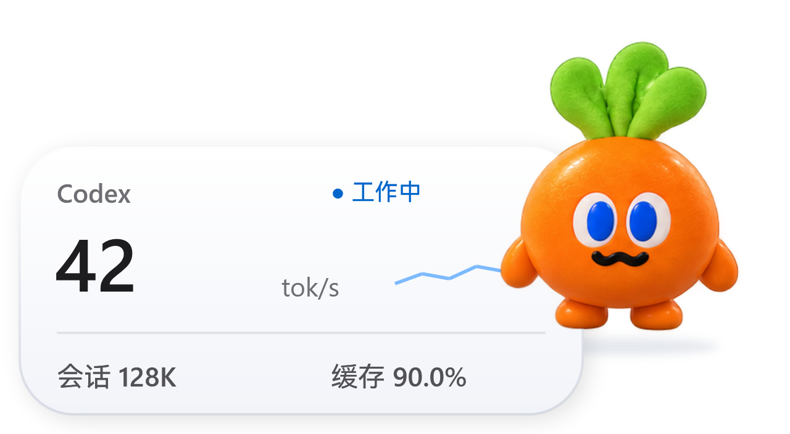
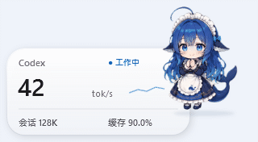

# 鲸鱼娘 · Codex 速度挂件

让鲸鱼娘陪你使用 Codex：一只可以自由拖动、轻轻滑行的桌面伙伴，配上一张小巧的模型速度卡片。

v0.2.0 新增 **右键 → 切换皮肤**：鲸鱼娘和卜卜风格胡萝卜共用同一个挂件，无需另外运行程序。胡萝卜为非官方二创，含 12 款表情；换肤保留位置、大小和统计会话。



**Windows x64 便携版 · 本机只读 · 无需 API Key · 不修改 Codex 安装文件**



> 预览中的 42 tok/s、128K 和 90% 均为合成演示数据，不是模型性能基准。上图为姿态与弹性动效预览，不是鼠标拖动实录。

## 下载与使用

在本仓库的 [最新发行版](https://github.com/lten44/codex-whale-companion/releases/latest) 下载 `WhaleCompanion-v0.2.0-windows-x64.zip`，完整解压到可写目录，然后双击 `WhaleCompanion.exe` 或 `启动鲸鱼娘.cmd`。

请下载 Releases 中的便携包；GitHub 的 **Code → Download ZIP** 是源码，需要自行构建。不要只把 `.exe` 单独发给朋友，`assets/` 和许可文件也必须一起保留。

适用于 Windows 10/11 x64，需要 .NET Framework 4.8。当前已在开发者的 Windows 电脑验证，尚未完成其他机器的兼容性验收；不支持 macOS、Linux 或原生 ARM64。发行文件未购买代码签名证书，如系统显示“未知发布者”，请核对下载来源和 SHA-256，勿关闭安全防护。

正常运行无需管理员权限、Python、Node、浏览器插件或付费 API。首次运行自动寻找当前用户的 Codex 本机日志；找不到时可右键选择 Codex 数据目录。未运行过 Codex 时仍可使用桌宠，统计显示为空。

## 可以做什么

- 默认 320×176 的浅色小卡片；85% 迷你档约 272×150，也可仅显示宠物。以上尺寸对应 100% 系统缩放。
- 89 款完整表情姿态、呼吸与弹性动画；摸头、投喂、夸夸和快速连点庆祝。
- 拖动后短距离惯性滑动、碰边回弹、记住位置；支持固定位置、精确坐标和减少动效。
- 显示日志记录的模型、本轮分段均速、会话累计 token 和缓存率；单击卡片查看详情。
- `Ctrl+Alt+W` 显示并复位，`Ctrl+Alt+H` 显示/隐藏；托盘菜单可退出。

完整操作见 [使用说明](使用说明.md)。

## 速度是怎样计算的

速度 = **本轮真实输出 token 增量 ÷ 模型输出时段的并集**。使用日志中的 `Reasoning` 与 `AgentMessage` 时间，包含推理 token，排除工具运行时间；小于 0.5 秒或缺少起点的样本不显示。

挂件每秒检查日志，但日志通常在每段模型输出结束后才提供完整样本。因此这是**分段更新的模型均速**，不能做到每个 token 的瞬时测速。新一轮会清空旧速度；初始思考或数据不足时显示“—”。不同累计来源分别记录基线，避免混用后误判为计数回退。

默认跟随最近有日志活动的会话，不能识别 Codex 侧栏当前打开的空闲聊天。可以锁定会话或手动选择历史日志。会话 token 不是当日账号总用量；缓存是输入的一部分，不重复计入总量。参考费用需要自行填写单价，不代表订阅实际扣费或节省现金。

v0.2.0 自动跟随会跳过 `codex-auto-review` 内部审核日志，避免工具审批后模型名与速度被审核会话替换；手动锁定的会话仍按你的选择读取。

中途启动遇到超过 4MB 的长轮次时，会按需向前读取直到恢复模型与本轮计数起点；首次读取可能多花几秒，后续仍只跟踪新增内容。

## 隐私

挂件只读取 `CODEX_HOME` 或当前用户目录下 `.codex/sessions` 的本地日志，不读取登录凭据，不请求网络，不上传聊天，不调用模型 API。

位置与偏好保存在同目录 `settings.json`；运行状态、错误和诊断输出也保留在本机。分享时请使用发行包，不要直接压缩自己正在使用的整个目录。发行脚本使用明确文件清单，不包含设置、聊天日志、会话标识或诊断输出。

## 构建与验证

在 Windows PowerShell 中运行：

```powershell
powershell -NoProfile -ExecutionPolicy Bypass -File build.ps1
.\WhaleCompanion.exe --self-test
Get-Content .\selftest-result.txt
```

构建使用系统的 .NET Framework C# 编译器，不下载生产依赖。若挂件正在运行，请先退出，或使用 `build.ps1 -OutputName WhaleCompanion.next.exe` 输出另一个文件。

生成便携包、源码包及 SHA-256 清单：

```powershell
powershell -NoProfile -ExecutionPolicy Bypass -File release.ps1
```

`--self-test` 检查计数去重、不同来源的累计口径、缺失起点、UTF-8 断行、文件截断、弹簧收敛与惯性边界。`--preview` 导出合成演示图和布局检查；`--probe` 读取本机真实日志并产生诊断摘要，请勿公开该摘要。

## 引用与许可

**角色与立绘来自 [Sutera-Diffusus/dsh-whale-musume](https://github.com/Sutera-Diffusus/dsh-whale-musume)，感谢原作者。** 92 张素材及衍生图标保留其 MIT 许可和版权声明，详见 [第三方引用说明](THIRD-PARTY-NOTICES.md)。

统计方法参考 [dongyue-19/codex-statusbar](https://github.com/dongyue-19/codex-statusbar)，另调研 [zzccchen/token-pulse](https://github.com/zzccchen/token-pulse)。轻盈材质和信息层级参考 [Apple HIG](https://developer.apple.com/design/human-interface-guidelines/materials)。实际使用素材与方案参考在引用说明中分别列出。

本项目代码采用 [MIT License](LICENSE)。这是社区独立工具，与 OpenAI、Apple、DeepSeek 无官方隶属或背书关系。Codex 本机日志不是稳定公开接口，应用更新后可能需要适配。
